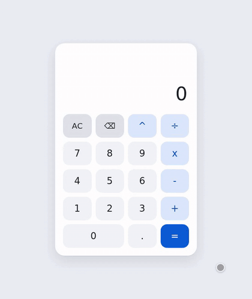

# Calculator

A simple binary calculator (two operands, one operator) with a React + TypeScript frontend and a Go
REST backend. The backend evaluates operations and validates them; the frontend handles input,
display formatting and accessibility.

- Operators: `+`, `-`, `x`, `÷`, `^`
- Chain operations (`12 x 2 +` → `24 +`), and press `=` again to repeat the last operation
  (`10 + 1 = 11`, `=` → `12`, `=` → `13`)
- Scientific notation for |x| ≥ 1e10 and 0 < |x| ≤ 1e-10
- Results rounded to 15 significant digits (so `0.1 + 0.2 = 0.3`); limits of ±1e100 and ±1e-100
- Invalid operations (e.g. division by 0) show a temporary `Invalid: …` message
- Works with mouse, touch and keyboard; screen-reader friendly; light and dark themes

## Demo



The recording shows, in order:

1. A basic operation: `12 x 2 =` → `24`
2. Chaining: `+ 6`, then `x` evaluates `24 + 6` and continues with `30 x`; `2 =` → `60`
3. Repeated `=`: `120`, `240`
4. A negative second operand and decimals: `0.5 - -1.5 =` → `2`
5. Scientific notation: `99999 x 99999 =` → `9999800001`, then `x 10 =` → `9.999800001e+10`
6. An invalid operation: `5 ÷ 0 =` shows a temporary error and keeps the input
7. Delete: `⌫` removes the `0`, then `4 =` → `1.25`

## Creation approach

I first spent some time thinking about how I'd want the calculator to work. This included me playing around with a basic physical calculator I have at home, plus trying a few digital ones such as the one on my phone and a few online options.

After that, I laid down the overall design, which can be found at [`INITIAL_DESIGN.md`](INITIAL_DESIGN.md). These were the requirements passed to Claude Code (Opus 5.5), using this prompt:

```
Hi, I have a design for a calculator app in @INITIAL_DESIGN.md, could you read it and before implementing anything, come up with a plan? We'll want that plan in its own file. Ask me any questions about stuff that's not clear or needs to be specified further.
```

The detailed plan was written to [`PLAN.md`](PLAN.md). It was changed slightly a few times as the requirements were refined. The refinement included both my comments on it and Claude asking me to make decisions.

Once I was happy with the plan, I asked Claude to go ahead and implement it, which was done in stages.

## Design decisions / assumptions

The core idea started with wanting a simple calculator. This was in part informed by the following point from the assignment instructions: `Expose endpoints for calculator operations`. From that, I assumed that we wanted separate endpoints for each operation type. Based on that, I landed on the idea of a binary (two operands, e.g. `2 x 5`) calculator. We could instead have had a single endpoint that would accept complex expressions (e.g. `1 + (3 x (1 - 9)) - 5`), but that went against the assumption above. Note that it'd have still been possible to support those kinds of complex expressions while having separate endpoints per operation. It's just that we'd have to break expressions down and make multiple backend requests, which I don't like.

Sticking with the idea of a simple calculator, I wanted one that was not only simple in scope, but simple to use. That's why in [`INITIAL_DESIGN.md`](INITIAL_DESIGN.md) I focused quite a bit on its expected behavior. Specifically, scenarios of what would happen when the user did X or Y when the current state was A or B.

The simplicity theme was also present for the implementation. That's why I went with a `float64` (with rounding) representation for numbers, rather than a decimal representation (potentially more accurate but much more cumbersome). This was one of the points that Claude asked me about.

## Running it

### Run with Docker

Builds the frontend and backend and runs them together in one container:

```sh
docker build -t calculator .
docker run --rm -p 8080:8080 calculator
```

Then open <http://localhost:8080>. The Go server serves the API under `/api` and the built frontend
for everything else.

### Run for development

Requirements: Go 1.27+ and Node.js 24.15+ (22.22+ or 26+ also work).

In one terminal, start the backend on `localhost:8080`:

```sh
cd backend
go run .
```

In another, start the frontend dev server (with hot reload):

```sh
cd frontend
npm install
npm run dev
```

Then open the URL Vite prints (usually <http://localhost:5173>). The dev server forwards `/api`
requests to the backend.

## Tests and coverage

Unit tests cover the calculation logic, the HTTP API, the frontend input state machine, number
formatting, the API client and the UI components.

**Backend**

```sh
cd backend
go test ./...                                     # run the tests
go test -coverprofile=coverage.out ./...          # tests + coverage profile
go tool cover -func=coverage.out                  # per-function coverage in the terminal
go tool cover -html=coverage.out -o coverage.html # browsable report: open backend/coverage.html
```

**Frontend**

```sh
cd frontend
npm test               # run the tests
npm run test:coverage  # tests + coverage: summary in the terminal, report in frontend/coverage/index.html
npm run test:watch     # re-run tests on change
npm run lint           # oxlint
npm run build          # type-check and production build
```

### Coverage report

A snapshot of both coverage reports is committed in [`coverage-report/`](coverage-report), so you
can look at them without running anything:

| Report | Open | Coverage |
|---|---|---|
| Backend | `coverage-report/backend.html` | 93.0% of statements (about 98% excluding `main()`, which only reads settings and starts the server) |
| Frontend | `coverage-report/frontend/index.html` | 99.6% of statements, 99.0% of branches, 100% of functions |

GitHub shows HTML files as source code, so clone the repository (or download it as a ZIP) and open
the files in a browser, e.g. on Linux:

```sh
xdg-open coverage-report/backend.html
xdg-open coverage-report/frontend/index.html
```

(`open` on macOS, `start` on Windows, or drag the file into a browser window.)

How to read them:

- **Backend:** pick a file from the dropdown at the top (it lists each file's percentage). Green
  lines ran during the tests, red lines didn't, grey lines aren't counted.
- **Frontend:** the first page lists folders with their percentages; click through to a file to
  see its code. Red lines never ran, yellow highlights are branches never taken (`I`/`E` mark an
  `if`/`else` path not taken), and the numbers in the margin count how often each line ran.

To refresh the snapshot after changing the code, regenerate both reports and copy them over:

```sh
(cd backend && go test -coverprofile=coverage.out ./... && go tool cover -html=coverage.out -o coverage.html)
(cd frontend && npm run test:coverage)
rm -rf coverage-report && mkdir -p coverage-report
cp backend/coverage.html coverage-report/backend.html
cp -r frontend/coverage coverage-report/frontend && rm -rf coverage-report/frontend/lcov-report coverage-report/frontend/lcov.info
```

## Keyboard input

| Key | Action |
|---|---|
| `0`–`9` | Digits |
| `.` or `,` | Decimal point |
| `+` `-` `*` (or `x`) `/` `^` | Operators |
| `Enter` or `=` | Evaluate (again: repeat the last operation) |
| `Backspace` or `Delete` | Delete the last symbol |
| `Escape` | Clear everything |

## API

One `POST` endpoint per operator: `/api/add`, `/api/subtract`, `/api/multiply`, `/api/divide`,
`/api/power`. Plus `GET /api/health`.

Every operator endpoint takes the same request body and returns the same response shape. Operands
and results are numbers encoded as strings, so no precision is lost; operands may use exponent
notation (`"3e+12"`), so a previous result can be sent back as is. Clients format numbers for
display themselves.

```jsonc
// Request
{ "left": "12", "right": "2" }

// Response
{
  "ok": true,                // whether the operation succeeded
  "operation": {             // what was evaluated, operands in canonical form (null on 400)
    "operator": "multiply",
    "left": "12",
    "right": "2"
  },
  "result": "24",            // null on failure
  "error": null              // { "code", "message" } on failure
}
```

### Examples

The responses below are real output from the server, pretty-printed for readability (the server
returns compact JSON; pipe through `jq` to format it the same way). Run the server with `go run .`
in `backend/`, or with Docker as above.

**Multiply** (`200`)

```sh
curl -X POST localhost:8080/api/multiply -H 'Content-Type: application/json' -d '{"left":"12","right":"2"}'
```
```json
{
  "ok": true,
  "operation": {
    "operator": "multiply",
    "left": "12",
    "right": "2"
  },
  "result": "24",
  "error": null
}
```

**Add**: results are rounded to 15 significant digits, so binary floating-point artifacts disappear (`200`)

```sh
curl -X POST localhost:8080/api/add -H 'Content-Type: application/json' -d '{"left":"0.1","right":"0.2"}'
```
```json
{
  "ok": true,
  "operation": {
    "operator": "add",
    "left": "0.1",
    "right": "0.2"
  },
  "result": "0.3",
  "error": null
}
```

**Subtract** with a negative operand (`200`)

```sh
curl -X POST localhost:8080/api/subtract -H 'Content-Type: application/json' -d '{"left":"10","right":"-5"}'
```
```json
{
  "ok": true,
  "operation": {
    "operator": "subtract",
    "left": "10",
    "right": "-5"
  },
  "result": "15",
  "error": null
}
```

**Divide** (`200`)

```sh
curl -X POST localhost:8080/api/divide -H 'Content-Type: application/json' -d '{"left":"1","right":"3"}'
```
```json
{
  "ok": true,
  "operation": {
    "operator": "divide",
    "left": "1",
    "right": "3"
  },
  "result": "0.333333333333333",
  "error": null
}
```

**Power** with a fractional exponent (`200`)

```sh
curl -X POST localhost:8080/api/power -H 'Content-Type: application/json' -d '{"left":"2","right":"0.5"}'
```
```json
{
  "ok": true,
  "operation": {
    "operator": "power",
    "left": "2",
    "right": "0.5"
  },
  "result": "1.4142135623731",
  "error": null
}
```

**Exponent notation and canonical operands**: `"3e+12"` and `"5."` are accepted and echoed back in
canonical form (`200`)

```sh
curl -X POST localhost:8080/api/multiply -H 'Content-Type: application/json' -d '{"left":"3e+12","right":"5."}'
```
```json
{
  "ok": true,
  "operation": {
    "operator": "multiply",
    "left": "3000000000000",
    "right": "5"
  },
  "result": "15000000000000",
  "error": null
}
```

**Invalid operation: division by 0** (`422`)

```sh
curl -X POST localhost:8080/api/divide -H 'Content-Type: application/json' -d '{"left":"5","right":"0"}'
```
```json
{
  "ok": false,
  "operation": {
    "operator": "divide",
    "left": "5",
    "right": "0"
  },
  "result": null,
  "error": {
    "code": "DIVISION_BY_ZERO",
    "message": "Division by 0"
  }
}
```

**Invalid operation: result over the limit** (`422`)

```sh
curl -X POST localhost:8080/api/power -H 'Content-Type: application/json' -d '{"left":"10","right":"101"}'
```
```json
{
  "ok": false,
  "operation": {
    "operator": "power",
    "left": "10",
    "right": "101"
  },
  "result": null,
  "error": {
    "code": "RESULT_TOO_LARGE",
    "message": "Result is too large"
  }
}
```

**Bad request: operand isn't a number** (`400`, `operation` is `null`)

```sh
curl -X POST localhost:8080/api/add -H 'Content-Type: application/json' -d '{"left":"abc","right":"2"}'
```
```json
{
  "ok": false,
  "operation": null,
  "result": null,
  "error": {
    "code": "INVALID_INPUT",
    "message": "Invalid number"
  }
}
```

**Bad request: operand over the limit** (`400`)

```sh
curl -X POST localhost:8080/api/add -H 'Content-Type: application/json' -d '{"left":"1e101","right":"2"}'
```
```json
{
  "ok": false,
  "operation": null,
  "result": null,
  "error": {
    "code": "OPERAND_OUT_OF_RANGE",
    "message": "Number is out of range"
  }
}
```

**Health check** (`200`)

```sh
curl localhost:8080/api/health
```
```json
{
  "status": "ok"
}
```

### Error codes

| Code | Status | When |
|---|---|---|
| `DIVISION_BY_ZERO` | 422 | `x ÷ 0` |
| `ZERO_TO_NEGATIVE_POWER` | 422 | `0 ^ -n` |
| `COMPLEX_RESULT` | 422 | negative base with a non-integer exponent |
| `RESULT_TOO_LARGE` | 422 | \|result\| > 1e100 |
| `RESULT_TOO_SMALL` | 422 | 0 < \|result\| < 1e-100 |
| `OPERAND_OUT_OF_RANGE` | 400 | an operand is outside the limits |
| `INVALID_INPUT` | 400 | malformed request or operand (`operation` is `null`) |

## Configuration

The backend reads these environment variables:

| Variable | Default | Description |
|---|---|---|
| `HOST` | `localhost` (`0.0.0.0` in Docker) | Address to bind |
| `PORT` | `8080` | Port to listen on |
| `STATIC_DIR` | none (`/app/static` in Docker) | Directory of built frontend files to serve |
| `ALLOWED_ORIGINS` | none | Comma-separated origins allowed to call the API cross-origin |

The frontend reads `VITE_API_BASE_URL` at build time if the API lives on a different origin (by
default it calls the same origin).

## Project layout

```
backend/
  main.go               configuration and startup
  internal/calc/        evaluation, limits, rounding, parsing (no HTTP)
  internal/api/         routes, handlers, CORS, static file serving
frontend/src/
  api/client.ts         typed client for the backend
  calculator/           input state machine, formatting, spoken text, keyboard, hooks
  components/           Calculator, Display, Keypad
Dockerfile              multi-stage build: frontend + backend → one small image
```
